<picture>
  <source media="(prefers-color-scheme: dark)" srcset="assets/banner-dark.svg">
  
</picture>

 

<a href="https://apapeisname.github.io/">
  <picture>
    <source media="(prefers-color-scheme: dark)" srcset="assets/blog-button-dark.svg">
    
  </picture>
</a>

  

 

### 지금 하고 있는 것

현직 개발자로 일하면서 MIT, CMU, 버클리, 스탠퍼드 학부 핵심 과목을 참고한 CS 독학 과정을 진행하고 있어요. 대학 강의처럼 주차별로 공부하고, 과제마다 리포트를 블로그에 제출해요. 진도와 일정은 [대시보드](https://apapeisname.github.io/)에서, 전체 주차는 [계획서](https://apapeisname.github.io/syllabus/)에서 볼 수 있어요.

| | 시즌 | 참고 강의 | 보스 과제 |
|:-:|---|---|---|
|  | S1 프로그램의 구조와 해석 | Berkeley CS 61A | 61A 프로젝트 |
|  | S2 컴퓨터 시스템 | CMU 15-213 | Malloc Lab |
|  | S3 운영체제 | Berkeley CS 162 | 생산자-소비자 큐 |
|  | S4 컴퓨터 과학을 위한 수학 | MIT 6.042J | 해시 충돌 확률 검증 |
|  | S5 알고리즘 | Skiena | 지하철 최단 경로 탐색기 |
|  | S6 컴퓨터 네트워크 | Stanford CS 144 | 소켓 HTTP 서버 |
|  | S7 데이터베이스 시스템 | Berkeley CS 186 | 나만의 KV 저장소 |
|  | S8 언어와 인터프리터 | Crafting Interpreters | 나만의 Lox |
|  | S9 분산 시스템 | MIT 6.824 | Raft 구현 |

### 2026년 목표

읽고 있는 책과 다음에 읽을 책은 [2026goal.md](./2026goal.md)에 정리하고 있어요.

배너의 픽셀 폰트는 <a href="https://github.com/quiple/galmuri">갈무리</a>(SIL OFL 1.1)를 썼어요.
