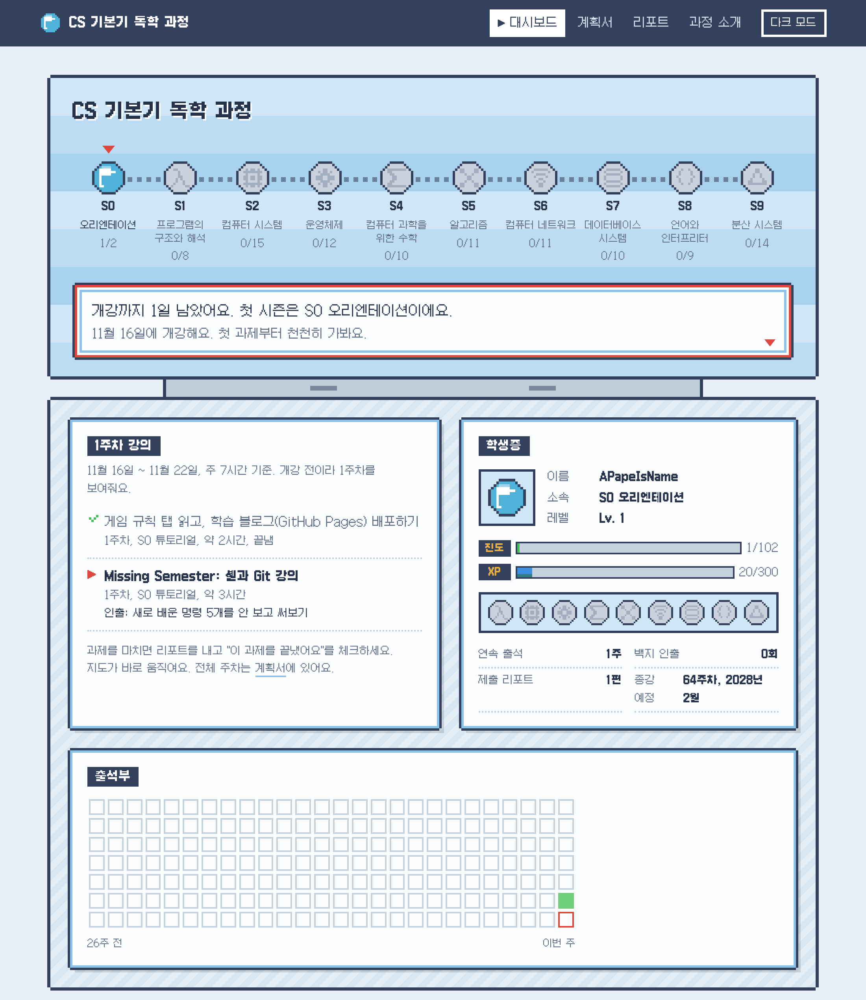

<picture>
  <source media="(prefers-color-scheme: dark)" srcset="assets/banner-dark.svg">
  
</picture>

 

<a href="https://apapeisname.github.io/">
  <picture>
    <source media="(prefers-color-scheme: dark)" srcset="assets/blog-button-dark.svg">
    
  </picture>
</a>

  

  

<a href="https://apapeisname.github.io/">
  <picture>
    <source media="(prefers-color-scheme: dark)" srcset="assets/blog-dark.png">
    
  </picture>
</a>

